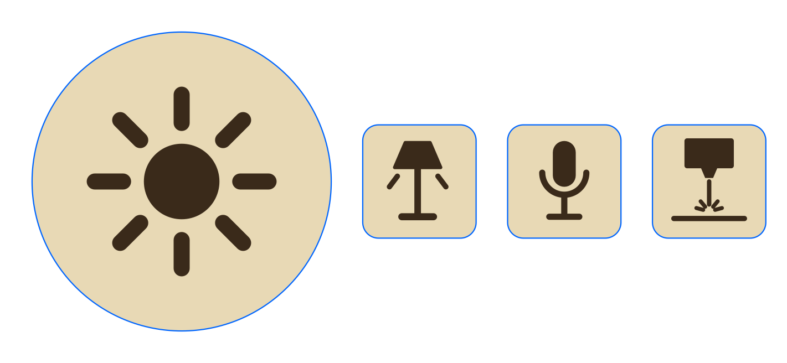

# KB16 key stickers

Four stickers for the DOIO KB16, cut and engraved on 0.2 mm adhesive cardboard with an xTool S1 40 W.



| Sticker | Size | Goes on |
|---|---|---|
| Sun (brightness) | 28.5 mm circle | big dial (top ~29.5 mm) |
| Floor lamp (corner light) | 10.8 mm square, 1.5 mm corners | top-right key (top ~11.8 mm) |
| Microphone (dictation) | same | bottom-left key |
| Laser head (laser plug) | same | bottom-right key |

0.5 mm clearance on every side. The dial icon is rotation-symmetric because the sticker turns with the knob.

## Run

1. `sticker_test.xcs` first. Row 1: five 6 mm cut squares at P10/15/20/25/30, S200 (left to right).
   Pick the lowest power that cuts the cardboard but leaves the liner (kiss cut). Row 2: four 5 mm engraved
   squares at P8/12/16/20, S300, 150 lpc, one-way. Pick the darkest clean one.
2. Set `ENGRAVE` and `CUT` at the top of `make_stickers.py`, regenerate, run `stickers.xcs`.
   (Or just change the two layers' settings in xTool Studio.)

```zsh
/Volumes/SSD2/venvs/keycap-stickers/bin/python make_stickers.py   # -> stickers.xcs, sticker_test.xcs, preview.png
```

Venv: `/Volumes/SSD2/venvs/keycap-stickers` (shapely, numpy, matplotlib). The .xcs format and builders follow
`~/dev/diy/builds/business-cards/second_mountain_labs_on_steel_blanks/sml-card-laser/make_card_test.py`.

Status (2026-10-21): generated, not yet run on the machine. ENGRAVE P12/S300 and CUT P20/S200 are guesses.
